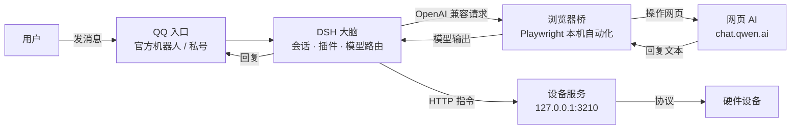
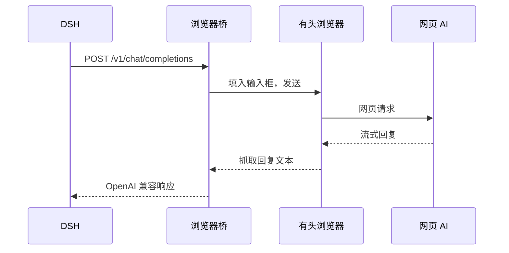
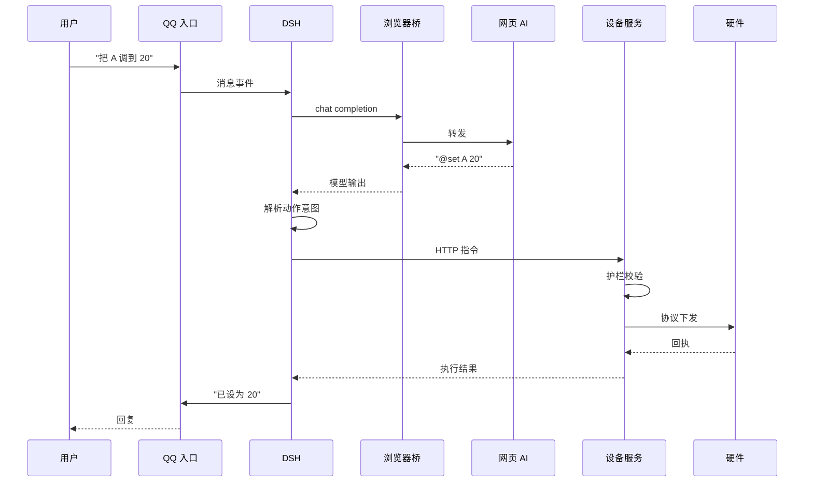

# AI 模型接入接出与插件

> 一套把「聊天入口 → AI 大脑 → 网页模型 → 本机设备」串成闭环的本地架构归档。

本仓库是这套架构的实现归档，包含四部分：

- **郊狼手柄**（`郊狼手柄/`）：「狐狸兔开发组」编写的设备执行层，把指令变成真实的设备动作
- **星涟控制台**（`星涟控制台/`）：第三方项目「星涟联动 · Coyote Link」的源码归档，**非本仓库原创**，出处见下方「关于星涟」
- **教学文档**（`教学文档/`）：架构讲解与视频口播稿
- **截图**（`截图/`）：关键环节的界面留痕

本仓库只讲**原理与架构**，不包含任何个人配置、账号、密钥或运行数据。

## 关于星涟

`星涟控制台/` 目录收录的是第三方项目「星涟联动 · Coyote Link」，**不是本仓库作者原创**。

- 原出处：B 站视频【星涟agent—AIxx人类了！】<https://www.bilibili.com/video/BV1FrnG6xEVV>
- 收录目的：作为「控制台层」的参考实现，配合本仓库的架构讲解；
- 版权归原作者所有，本仓库仅作学习归档，不主张任何原创权。
- 本仓库其余内容（`郊狼手柄/`、`教学文档/`、`截图/` 的整理与本文档）由「狐狸兔开发组」编写。

---

## 一、它解决什么问题

通常，一个「让 AI 控制设备」的系统长这样：调用云端模型 API → 返回指令 → 驱动硬件。这条链路有两个现实问题：

1. **成本**：按 token 计费的 API 持续调用，长期成本不可控；
2. **封闭**：模型、入口、设备三者绑死在某一家的生态里，难以替换。

这套架构换了个拼法：**入口用聊天软件，大脑用本地 Agent 框架，模型复用网页端免费额度，动作回到本机执行**。每一层都可以独立替换，整条链路没有一个按量计费的 API。

---

## 二、整体架构



四个部件各司其职：

| 层 | 部件 | 职责 | 可替换性 |
| --- | --- | --- | --- |
| 入口层 | QQ（机器人或私号） | 承接用户消息，是唯一的人机界面 | 可换成任意聊天平台 |
| 大脑层 | DeepSeek Harness（DSH） | 会话管理、插件调度、模型路由 | 可换成任意 Agent 框架 |
| 模型层 | 浏览器桥 + 网页 AI | 把网页模型包装成本地 OpenAI 兼容接口 | 可换成任意有网页端的模型 |
| 执行层 | 设备服务 | 把文本指令变成真实的设备动作 | 可换成任意设备协议 |

---

## 三、逐层拆解

### 1. 入口层：QQ

接入有两条路，任选一条，大脑层不用改：

- **官方机器人**：在 QQ 开放平台注册，拿到 AppID 与 Secret，通过官方 HTTP 通道收发消息，不需要登录 QQ 客户端。
- **私号接入**：用 NapCat 把 QQ 私号变成协议端，再用 Koishi 做消息框架，把消息转发给 DSH。适合官方机器人限额或功能不足的场景。

入口层只做一件事：**把用户的话原样送进大脑，再把大脑的回复原样送回去**。它不参与决策。

### 2. 大脑层：DSH

DSH 是整条链路的中枢，负责：

- **会话**：维持多轮上下文，记录谁在什么时候说了什么；
- **插件**：把「调设备」「查状态」「发指令」封装成可调用的工具；
- **模型路由**：决定这一轮用哪个模型、走哪个接口。

DSH 不直接碰硬件，它只产出**结构化的动作意图**，交给执行层落地。

### 3. 模型层：浏览器桥

这是整套架构里最省钱的一环。

原理：用 Playwright 在本机拉起一个**有头浏览器**（真实窗口，不是无头模式），登录网页版 AI；桥在本地开一个 OpenAI 兼容的 `/v1/chat/completions` 接口；DSH 里配一个自定义 provider 指向它，就能把网页 AI 当成普通模型使用。



关键点：

- **登录态**由浏览器自己持有，桥只负责驱动，不碰账号密码；
- **流式输出**靠监听网页 DOM 的变化还原，而不是解析官方 API；
- 桥是**本机进程**，不对外暴露端口，网页 AI 的额度耗在网页端，不经过任何第三方计费网关。

### 4. 执行层：设备服务

设备服务是一个只监听 `127.0.0.1` 的 HTTP 服务，默认端口 `3210`，在仓库里对应 `郊狼手柄/` 目录。它把大脑发来的指令翻译成设备协议动作：

- `@set A 20`：把 A 通道强度设为 20
- `@pulse <波形>`：播放一段脉冲
- `@stop`：停止输出

服务端有一层**硬护栏**（见第六节），任何越界指令都会被拒绝或夹到安全范围内，而不是直接下发。

---

## 四、星涟控制台内部（第三方项目）

> 注意：`星涟控制台/` 收录的是第三方项目，**不是本仓库作者原创**，原出处见文首「关于星涟」。以下内容是对该项目的架构解读，作为「控制台层」的参考实现。

`星涟控制台/` 是一个跑在本机 `127.0.0.1:3000` 的 Web 应用，对应架构中的「台面」部分。

### 前端

- React 19 + Vite，单页应用；
- 四个工作区：**控制台**（实时控制）、**AI 控制**（自然语言驱动）、**AI 上锁任务**（长时任务）、**系统设置**；
- A/B 双通道独立强度与设备上限，实时控制热更新；
- 界面状态通过 WebSocket 流式同步，断线自动重连并回填真实状态。

### 后端

- Express 5 + tsx 直接运行 TypeScript，无编译产物依赖；
- 核心模块：
  - `controller.ts`：控制核心，管理通道、阶段、上锁与状态机；
  - `device.ts`：设备连接与中继，负责与硬件握手；
  - `pulse.ts`：脉冲/波形的解析与播放调度；
  - `store.ts`：本地持久化（SQLite），密钥加密落盘；
  - `ai.ts`：模型调用的传输层，含超时与中断处理。

### AI 代理层

`agent/` 目录是独立于 Web 服务的 AI 运行时（基于 eve 框架），它：

- 把用户的自然语言转成结构化的设备动作；
- 通过 `inference.ts` 与 `provider.ts` 对接任意 OpenAI 兼容接口（包括浏览器桥）；
- 用 `schemas.ts` 约束模型输出，非法结构直接拒绝，不进入执行层。

### 设备层与脉冲格式

设备通信基于公开的 DG-LAB 协议（`dglab-kit`）。脉冲是**毫秒级线性强度序列**，格式规范见 `星涟控制台/docs/PULSE_FORMAT.md`。播放器按周期逐点下发，支持渐变、补齐与受限随机。

### 安全护栏

这是整套系统里最不能省的部分：

| 护栏 | 作用 |
| --- | --- |
| `hardMax` | 绝对上限，任何来源都不能超过 |
| `stepMax` | 单次最大变化量，防突跳 |
| `minIntervalMs` | 最小下发间隔，防高频刷 |
| `watchdogMs` | 无人喂看门狗时自动归零 |
| 执行策略 | AI 产出的动作先过 schema 校验，再进队列 |

护栏在**服务端**强制执行，不依赖前端或模型自觉。

---

## 五、一条指令的生命周期



一次完整的往返里，**模型只负责「说什么」，护栏负责「能不能做」**。模型看到执行结果后，下一轮就能判断深浅。

---

## 六、为什么这样设计

1. **入口与大脑解耦**：QQ 只是通道，换成 Discord、Telegram 或网页聊天，大脑层一行不用改。
2. **模型与计费解耦**：网页 AI 走浏览器，不经过按量计费的 API 网关；换模型只需换一个网页端和一次登录。
3. **执行与决策解耦**：模型可以胡说，但设备服务只执行通过护栏的动作；最坏情况是被拒绝，而不是失控。
4. **全部本地**：所有服务只监听 `127.0.0.1`，不对外暴露端口；数据、密钥、登录态都留在本机。

---

## 七、技术栈

| 层 | 主要技术 |
| --- | --- |
| 控制台前端 | React 19、Vite 6、TypeScript、WebSocket |
| 控制台后端 | Express 5、tsx、SQLite、zod |
| AI 运行时 | eve 0.80、AI SDK 7、OpenAI 兼容协议 |
| 浏览器桥 | Playwright、Node.js |
| 设备通信 | dglab-kit 1.0.5（DG-LAB 公开协议） |
| 运行环境 | Node.js 24+、pnpm 11+、Windows / macOS / Linux |

---

## 八、运行前提

- 星涟控制台（第三方项目）：见 `星涟控制台/README.md`（`pnpm install` → `pnpm build` → `pnpm start`，默认 `http://127.0.0.1:3000`）。
- 郊狼手柄：见 `郊狼手柄/README.md`（`node server.ts`，默认 `http://127.0.0.1:3210`；`config.json` 里的 `token` 留空时启动会自动生成）。
- 浏览器桥属于配套组件，不在本仓库内；接口约定见教学文档中的架构说明。
- 设备控制涉及真实硬件，运行前请确认已阅读并理解护栏参数，首次使用建议从最低强度开始。

---

## 九、仓库结构

```
.
├── README.md              ← 本文件（原理与架构）
├── 星涟控制台/             ← 第三方项目「星涟联动」源码（出处见文首）
│   ├── src/               ← 前端（React）
│   ├── server/            ← 后端（Express）
│   ├── agent/             ← AI 代理层
│   ├── shared/            ← 前后端共用类型与限额
│   ├── docs/              ← 脉冲格式、AI 超时、验证清单等
│   ├── tests/             ← 自动化测试
│   └── scripts/           ← 构建与浏览器验收脚本
├── 郊狼手柄/               ← 设备执行层（HTTP 服务，默认 3210）
│   ├── server.ts          ← 入口
│   ├── lib/               ← 配置、设备连接、波形播放
│   ├── public/            ← 网页遥控面板
│   └── tools/             ← 冒烟测试
├── 教学文档/
│   ├── 教学-架构.md        ← 整条链路的图文讲解
│   └── 教学-口播稿.md      ← 约 4 分钟的视频分镜与口播词
└── 截图/                   ← 关键环节界面留痕（说明见 截图/说明.md）
```

---

## 说明

- 本仓库为架构与实现归档，**不含**任何个人账号、密钥、登录态、运行数据库或本机路径。
- `星涟控制台/` 为第三方项目源码，版权归原作者所有，出处见文首「关于星涟」；其余内容（`郊狼手柄/`、`教学文档/`、`截图/` 整理与本文档）由「狐狸兔开发组」编写。
- 设备控制存在真实风险，请自行评估并遵守当地法律法规；本项目不提供任何形式的担保。
