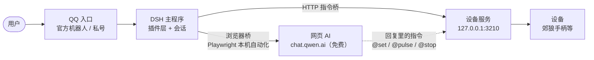

# 把 DSH 接进 QQ、再接上浏览器：一套“免费 AI + 设备控制”的架构

## 一张图看全

## 1. QQ 接入：两条路

### 路线 A：QQ 官方机器人
- 注册 QQ 开放平台机器人拿到 `AppID` + `Secret`
- DSH 里装机器人插件，填凭据、选目标群/私聊
- 一条 HTTP 通道就通了，不用动 QQ 客户端

### 路线 B：QQ 私号（Koishi + NapCat + DSH）
- **NapCat** 把 QQ 私号变成一个可调用的协议端
- **Koishi** 作为消息框架，把私聊/群消息转给 DSH
- 适合官方机器人限额或功能不够的情况

两条路选一条即可，DSH 侧不用改。

## 2. 浏览器桥：把网页 AI 变成“本地接口”

- 用 Playwright 起一个**有头浏览器**，登录网页 AI（本例是 chat.qwen.ai）
- 桥对外暴露 OpenAI 兼容的 `/v1/chat/completions`
- DSH 里配一个自定义 provider 指向桥，就能把这个网页 AI 当普通模型用
- 本机化操作，不碰官方 API，也不花额度

## 3. 设备桥：让回复里的指令真的动起来

- 设备服务（本例 coyote-hand）在 `127.0.0.1:3210` 提供 HTTP 接口
- 桥在回复里抓 `@set` / `@pulse` / `@stop` 这类指令，逐条调服务
- 结果再贴回对话，模型能看到“执行了没有”

## 4. 为什么这样拼

- **QQ 负责入口**：用户在哪，入口就在哪
- **DSH 负责大脑与插件**：会话、模型路由、工具调用
- **浏览器桥负责省钱**：网页 AI 免费额度顶上
- **设备桥负责落地**：文本指令变成真实操作

## 一句话总结

> 入口用 QQ，大脑用 DSH，模型走浏览器，动作回本机——整条链路没有一个按量计费的 API。
